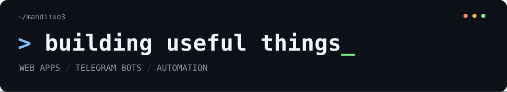
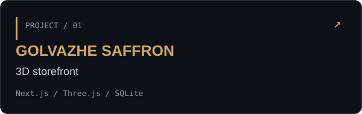
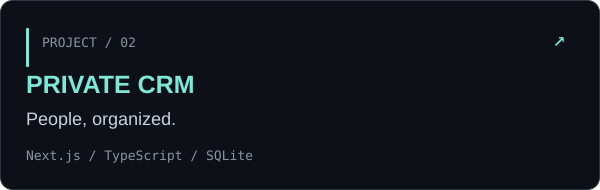
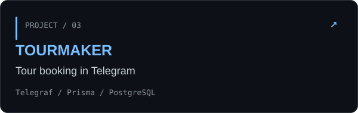
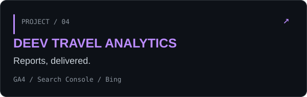
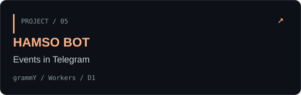
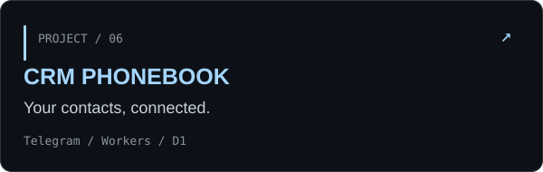
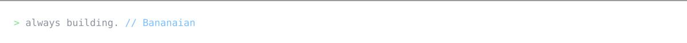

<table>
<tr>
<td width="48%" align="center" valign="middle">

</td>
<td width="52%" valign="middle">
<h2>Hello, I'm mahdiixo3 <code>_</code></h2>

I build Persian-first web apps, Telegram bots, and tools that make everyday work easier.

<pre lang="javascript">const workspace = {
  web: ["Next.js", "React"],
  bots: ["grammY", "Telegraf"],
  data: ["SQLite", "PostgreSQL"],
  focus: "useful things, well made"
};</pre>

<a href="#selected-work">Explore my projects ↓</a>

</td>
</tr>
</table>

## Selected work

از فروشگاه سه‌بعدی تا ابزارهای مدیریت و ربات‌های تلگرام؛ چند پروژه از کارهایی که می‌سازم.

<table>
<tr>
<td width="50%" valign="top">

فروشگاه زعفران با نمایش سه‌بعدی محصول، سبد خرید و پنل مدیریت.

</td>
<td width="50%" valign="top">

پنل فارسی مدیریت افراد، جست‌وجوی پرونده‌ها و خروجی اکسل.

</td>
</tr>
<tr>
<td valign="top">

ربات رزرو و مدیریت تور با همگام‌سازی اطلاعات از Google Sheets.

</td>
<td valign="top">

گزارش‌گیری تلگرامی از Google Analytics، Search Console و Bing.

</td>
</tr>
<tr>
<td valign="top">

مرور رویدادها، ثبت کاربر و مدیریت محتوای ربات در تلگرام.

</td>
<td valign="top">

دفترچه تلفن تلگرامی با دسته‌بندی، جست‌وجو و آمار مخاطبان.

</td>
</tr>
</table>

Source repositories are private. Project links are available to authorized collaborators.

## Built with

<code>TypeScript</code> · <code>JavaScript</code> · <code>Next.js</code> · <code>React</code> · <code>Three.js</code> · <code>Node.js</code> · <code>Cloudflare Workers</code> · <code>SQLite</code> · <code>PostgreSQL</code> · <code>Prisma</code>

